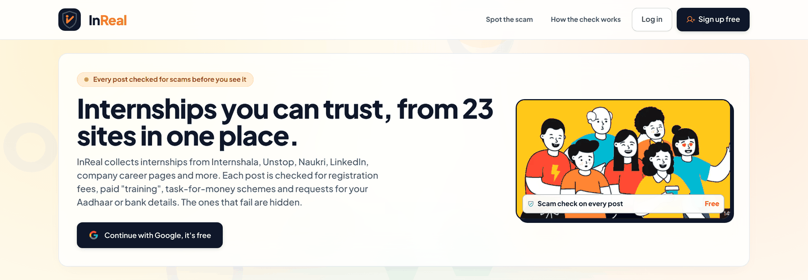
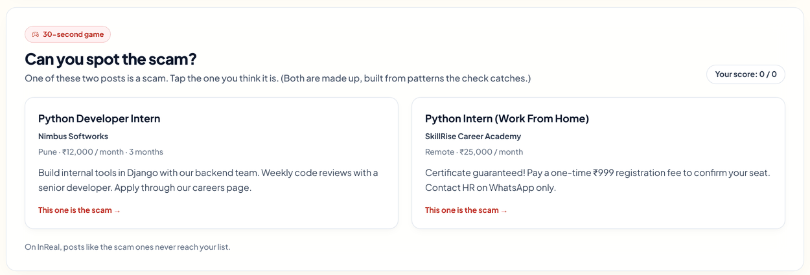
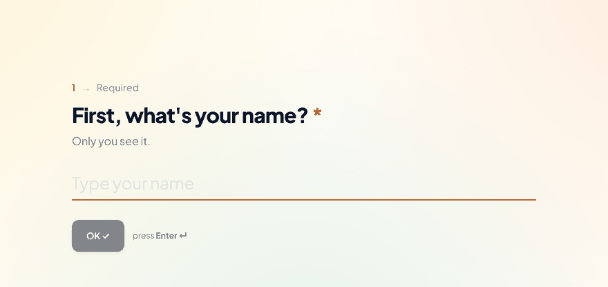
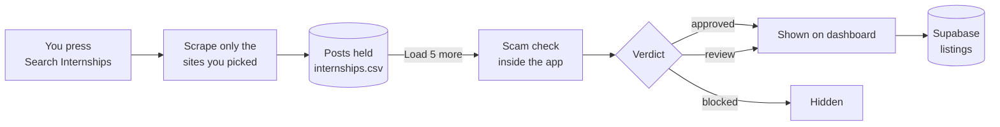

<div align="center">

<picture><source media="(prefers-color-scheme: dark)" srcset="docs/readme/banner-dark.svg"><source media="(prefers-color-scheme: light)" srcset="docs/readme/banner-light.svg"></picture>

**Internships from 23 sites in one search. Every post is checked for scams before you see it.**


</div>

<p align="center"></p>

---

## The problem

Looking for an internship means opening ten tabs, seeing the same post three times, and every so often
landing on one that says *"work from home, pay ₹999 registration"*. It looks real. It isn't.

**InReal does the searching and the checking for you.** You pick the sites, it collects the posts, and
it hides the ones that ask you for money, sell you a course dressed up as an internship, or pay you
for "tasks". What's left is sorted to match your profile.

---

## Where the internships come from

<p align="center"><picture><source media="(prefers-color-scheme: dark)" srcset="docs/readme/sources-dark.svg"><source media="(prefers-color-scheme: light)" srcset="docs/readme/sources-light.svg"></picture></p>

---

## How a post gets checked

<p align="center"><picture><source media="(prefers-color-scheme: dark)" srcset="docs/readme/check-dark.svg"><source media="(prefers-color-scheme: light)" srcset="docs/readme/check-light.svg"></picture></p>

The AI never gets the final word on its own. If it says *"scam"* but can't point to the exact line in
the post that proves it, the post is **not** hidden. Good internships don't disappear because the AI
had a hunch.

### What counts as a scam

<p align="center"><picture><source media="(prefers-color-scheme: dark)" srcset="docs/readme/scam-types-dark.svg"><source media="(prefers-color-scheme: light)" srcset="docs/readme/scam-types-light.svg"></picture></p>

These come from [`moderation/scam_patterns.json`](moderation/scam_patterns.json): 49 phrases seen in
real Indian internship scams, plus 15 honest versions of the same topics (*"we never charge a fee"*,
*"selection is through a technical interview"*). A post is compared with both by meaning, not exact
words, so a reworded scam still matches, and a post that *warns* about fees isn't mistaken for one that asks for them.

---

## Can you spot the scam?

The home page has a 30-second game. One of these two posts is a scam. Which one?

<p align="center"></p>

<sub>Answer: the one on the right. It asks for a ₹999 "registration fee" and wants you on WhatsApp only. Real internships never charge you to join.</sub>

---

## Made for you, not for everyone

<p align="center"></p>

- **Sign in with Google.** No password.
- **Answer a few questions,** one per screen: your field, your year, the roles and skills you want.
- **Your list sorts itself:** companies you like first, then your role, then your skills.
  Posts below your minimum stipend or outside your work mode are hidden.
- **Your profile is saved to your account,** so it follows you to any browser.

---

## Good to know

- **Sites change their pages.** A scraper can break without warning; `test_sites.py` and `SELECTOR_TRACKER.md` are how breakage is found and fixed.
- **The scam check is not perfect.** It blocks only on quoted evidence, so a cleverly worded scam can reach *review*. Always check the company before paying anything, and never pay to get an internship.
- **Google sign-in is in testing mode,** so only accounts added as test users can sign in until the app is published.
- **Runs on one computer.** Scraping and the scam check run locally; there is no hosted deployment yet.

---

## For developers

<details>
<summary><b>How the pipeline works</b></summary>

<br>



1. **Search.** You pick a field, regions and sites. Playwright and the sites' public APIs/RSS collect the posts.
2. **Hold.** New posts are held, not shown, until they are checked.
3. **Check.** *Load 5 more* sends the next posts to the scam check, which runs inside the app (`moderation/pipeline/`):
   - **Link check:** the apply link is opened (every redirect is checked, private addresses are refused); dead or closed posts are marked *Closed*, not scam.
   - **Rules:** known scam wording (fees, deposits, "pay to start").
   - **Vector search:** each post is compared with a bank of real scam examples (`moderation/scam_patterns.json`).
   - **LLM judge:** Azure gpt-4o reads 5 posts per call and must quote the exact line behind its verdict. Quotes are checked against the post, and a post is blocked only on evidence. A post that tries to give the AI instructions always goes to *review*.
   - **Second look (agent):** a LangGraph agent re-checks *review* posts in the background: it opens the company site and the apply link and searches the web (DuckDuckGo). Its quotes are checked against the pages it read; without proof the post stays in *review*.
4. **Publish.** Verdicts are saved and pushed to Supabase straight away (plus a sweep every 15 minutes), so signed-in users see them.
5. **Tidy up.** Posts older than 3 days are pruned when a new search starts. Posts still being checked are never pruned.

</details>

<details>
<summary><b>Pages</b></summary>

<br>

| Route | Who | What's there |
|---|---|---|
| `/` | Everyone | Landing page: live stats, a moving ticker of checked posts, a *Spot the scam* mini-game, a scroll-animated *How the check works*, and Google sign-in. |
| `/app` | Signed-in users | The dashboard: search, results, bookmarks, profile. Signed-in users are sent here from `/`. |
| `/admin` | This computer only | The admin dashboard, reachable from `localhost` only. |

</details>

<details>
<summary><b>Quick start</b></summary>

<br>

**You need:** Python 3.10+, a Supabase project, and (for the scam check) an Azure OpenAI deployment of gpt-4o and an embedding model.

```bash
git clone https://github.com/abhishekgoswami0720/InReal.git
cd InReal

python -m venv .venv
# Windows: .venv\Scripts\activate    macOS/Linux: source .venv/bin/activate

pip install -r requirements.txt
python -m playwright install chromium

cp .env.example .env        # then fill in your own keys (see below)
```

Then:

1. **Database.** In the Supabase SQL editor, run [`supabase/schema.sql`](supabase/schema.sql). It creates `profiles`, `listings` and `bookmarks` with row-level security. Details: [`supabase/README.md`](supabase/README.md).
2. **Google sign-in.** In Supabase → Authentication → Providers, turn on Google with your OAuth client, and add `http://localhost:5000` to the redirect URLs.
3. **Scam check.** Fill in the Azure keys in `.env`, then build the pattern index once: `python -m moderation.build_index`. Check that everything is connected with `python -m moderation.pipeline --sample` (3 made-up posts, nothing saved).
4. **Run.**
   ```bash
   python app.py
   ```
   Open **http://localhost:5000**. Use `localhost`, not `127.0.0.1`; the app redirects `127.0.0.1` because Google sign-in is tied to one address.

</details>

<details>
<summary><b>Configuration</b></summary>

<br>

All keys live in `.env`, which is git-ignored. **Never commit it**, and never put the secret key in browser code.

| Variable | Used for |
|---|---|
| `SUPABASE_URL` | Your Supabase project URL |
| `SUPABASE_PUBLISHABLE_KEY` | Browser sign-in and reads. Safe to expose. |
| `SUPABASE_SECRET_KEY` | Server-side publishing of verdicts. **Server only.** |
| `INREAL_ADMIN_TOKEN` | Optional: lets a remote caller scrape or clear data (header `X-InReal-Token`) |
| `INREAL_ALLOWED_HOSTS` | Optional: extra host names for a LAN setup. Empty = `localhost` only |
| `MOD_AGENT` | `on` / `off`: the agent's second look at *review* posts |
| `AZURE_OPENAI_GPT4O_ENDPOINT` / `_KEY` | The LLM judge |
| `AZURE_OPENAI_EMBEDDING_ENDPOINT` / `_KEY` | Embeddings for the scam-pattern index |
| `GEMINI_API_KEY` | Optional alternative to Azure for embeddings / judge |
| `AUTO_UPDATE`, `AUTO_EVERY_HOURS`, `AUTO_FIELDS`, `AUTO_LIMIT` | **Not used.** Left over from the removed autopilot; keep `AUTO_UPDATE=off`. |

</details>

<details>
<summary><b>Project layout</b></summary>

<br>

```text
InReal/
├── app.py                 # Flask app: pages, /api/scrape, security checks, publish loop
├── scraper.py             # Runs the picked site scrapers for one search
├── scraper_utils.py       # Shared browser / request helpers
├── sites/                 # One module per site group + registry.py (status of every site)
├── fields.py              # The 12 fields and their search words
├── filters.py, genuine.py # Title checks and the genuine-only rules
├── output_handler.py      # internships.csv store: statuses, de-duplication, 3-day pruning
├── supabase_sync.py       # Pushes checked posts to Supabase
├── moderation/            # Scam pattern bank, vector index, link check, judge evals, re-checks
│   └── pipeline/          # The scam check: rules, vectors, judge, fuse, runner, agent
├── supabase/              # schema.sql + access notes
├── templates/
│   ├── site.html          # Landing page  (/)
│   └── index.html         # Dashboard     (/app, /admin)
├── static/
│   ├── site.js            # Landing: ticker, Spot the scam, sign-in modal
│   ├── app_radar.js       # Dashboard: search, results, matching, profile sections
│   ├── onboarding.js      # One-question-at-a-time onboarding
│   ├── profile_options.js # Roles and skills per field, skill autocomplete
│   ├── background.js      # Animated glass background
│   └── theme.css          # Shared theme
├── tests/                 # pytest suite with saved HTML fixtures
├── run_public.bat         # Optional: share a read-only public link (Cloudflare tunnel)
└── autopilot.py           # Old automatic run. Not started by the app; don't use.
```

</details>

<details>
<summary><b>Testing</b></summary>

<br>

```bash
python -m pytest tests -q                                # full suite, no network needed
python scraper.py --source internshala --dry-run         # try one site without saving
python scraper.py --source internshala,unstop --field finance --dry-run
python test_sites.py naukri foundit                      # live check of chosen sites (needs internet)
```

`tests/test_no_auto_scrape.py` guards the main rule: `/api/scrape` refuses a request without picked
sites, scrapes only the sites given, and the app never starts the autopilot.

</details>

<details>
<summary><b>Sharing a public link</b></summary>

<br>

`run_public.bat` (Windows) starts the app and a temporary Cloudflare link to it. Visitors get a
**read-only** view; scraping and the scam check keep running on your computer. Google sign-in on that
link works only if you add the `trycloudflare.com` address to Supabase's redirect URLs.

</details>

<details>
<summary><b>All 23 sites and 12 fields</b></summary>

<br>

**12 fields:** AI / Machine Learning · Software & Web Development · Data Analytics · Medicine & Healthcare · Pharma & Biotech · Mechanical, Electrical & Civil · Finance & Accounting · Marketing & Sales · Design & Video · Content & Media · HR & Operations · Law

**23 tested sites:**

| India | Remote | Worldwide |
|---|---|---|
| Internshala, Unstop, Naukri, Shine, Foundit, Apna, AICTE (Govt), Cutshort, Talent.com India, Careerjet India, SimplyHired India | Remotive, We Work Remotely | LinkedIn, Microsoft, Google, Meta, Apple, NVIDIA, Amazon, Intel, Adobe, Salesforce |

The registry (`sites/registry.py`) lists 60 sites in total; only the 23 marked `tested` are offered in the search.
Selector notes for each site are in [`SELECTOR_TRACKER.md`](SELECTOR_TRACKER.md).

</details>

---

## Who built it

**InReal** is built by **Team Chiranjeevi** (CodeX 3.0, PIET Panipat, Oct 2026) and maintained by
[Abhishek Goswami](https://github.com/abhishekgoswami0720).

It started as a fork of the open-source **AI/ML Internship Radar** (MIT licence). The first commit in
this repository is that original code, unchanged; every later commit is our work: rebuilt scrapers,
the scam check, Supabase accounts, the profile and the new interface.

### License

[MIT](LICENSE). Copyright for the original code stays with the authors of AI/ML Internship Radar.

InReal only links to posts published on other sites. It doesn't own them, and a "checked" label is
guidance, not a guarantee.
